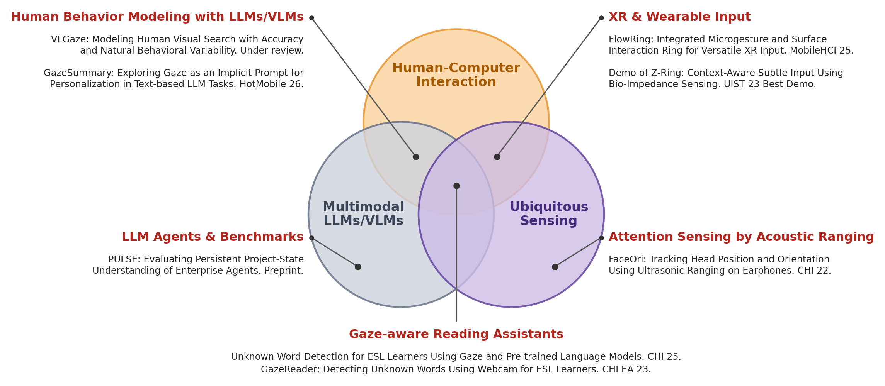
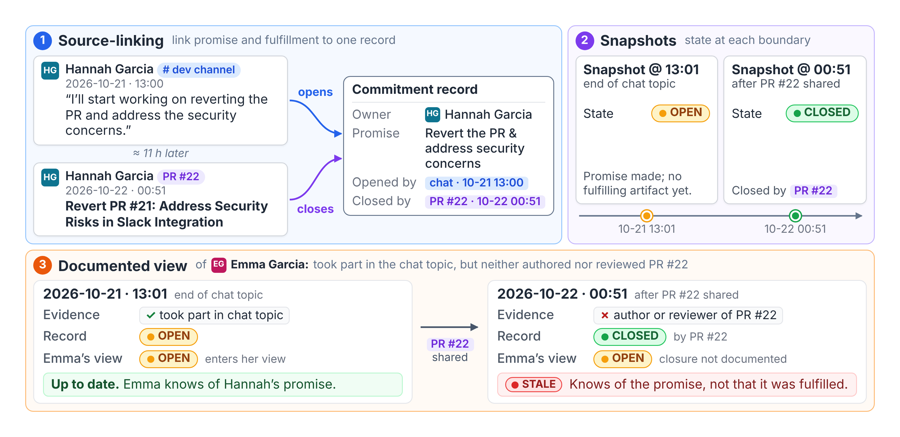
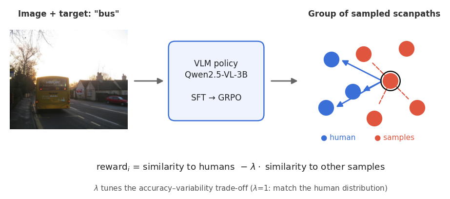
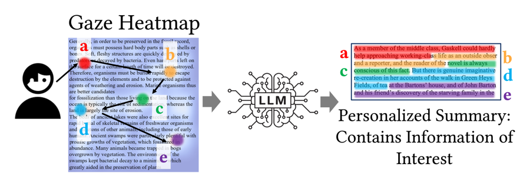

I am a PhD student in the Department of Electrical & Computer Engineering at the University of Washington, advised by Prof. Akshay Gadre and Prof. Shwetak Patel. I received my master’s degree in Information Science from a dual-degree program between the University of Washington and Tsinghua University in 2024. Prior to that, I earned my B.E. in Computer Science from Tsinghua University in 2021, along with a second bachelor’s degree (B.A.) in Product Design.

My research lies at the intersection of **multimodal LLMs** and **human-computer interaction**. I post-train LLMs/VLMs with supervised fine-tuning and reinforcement learning (GRPO) to understand and model human behavior from **eye tracking** and **wearable sensing**, enabling personalized, context-aware AI assistants — for example, modeling human visual search with a VLM ([VLGaze](https://drive.google.com/file/d/1diBcZHLuZOglUQNKuy4ITRXfikHLhld4/view?usp=sharing)) and using gaze as an implicit prompt for LLM personalization ([GazeSummary](https://dl.acm.org/doi/abs/10.1145/3789514.3792037)). I also build benchmarks and retrieval methods for **LLM agents** that reason over long-horizon, heterogeneous, and evolving context: as an Applied Scientist Intern at Microsoft (Copilot, Agents & Platform), I built [PULSE](https://arxiv.org/abs/2611.28374), a benchmark for persistent project-state understanding of enterprise agents. Previously, I worked on gaze-based reading assistance, wearable XR input, and acoustic sensing in the Ubicomp Lab at UW and the Pervasive HCI Lab at Tsinghua University, advised by Prof. Yuanchun Shi and Prof. Yuntao Wang.

**I am looking for research internships (Research Scientist / Applied Scientist) for Summer 2027. Feel free to reach out!**

## Selected Projects

  

  

    
<a href="https://arxiv.org/abs/2611.28374">Taking the PULSE of Enterprise Workflows: Evaluating Persistent Project-State Understanding</a>

    
<b>Jiexin Ding</b>, Lin Ai, Adam Davies, Scott Counts

    
Preprint, 2026 · Work done at Microsoft

    
A benchmark of 1,573 questions over 30 enterprise project histories testing whether agents know what is still open, what changed, and what each collaborator has (not) seen. Retrieval is the largest bottleneck, but explicit project state adds substantial gains even with gold evidence.

    
<a href="https://arxiv.org/abs/2611.28374">Paper</a><a href="/portfolio/portfolio-01-pulse/">Project</a>

  

  

  

    
<a href="https://drive.google.com/file/d/1diBcZHLuZOglUQNKuy4ITRXfikHLhld4/view?usp=sharing">VLGaze: Modeling Human Visual Search with Accuracy and Natural Behavioral Variability</a>

    
<b>Jiexin Ding</b>, Xinyun Liu, Ruotong Yu, Zhihan Zhang, Yuntao Wang, Shwetak Patel, Yue Jiang, Akshay Gadre

    
Under review, 2026

    
Post-trains a VLM with SFT and GRPO using a distribution-matching reward. VLGaze achieves state-of-the-art distributional metrics on COCO-Search18 while matching or beating all baselines on accuracy, with a tunable accuracy-variability trade-off.

    
<a href="https://drive.google.com/file/d/1diBcZHLuZOglUQNKuy4ITRXfikHLhld4/view?usp=sharing">Paper</a><a href="/portfolio/portfolio-02-vlgaze/">Project</a>

  

  

  

    
<a href="https://dl.acm.org/doi/abs/10.1145/3789514.3792037">GazeSummary: Exploring Gaze as an Implicit Prompt for Personalization in Text-based LLM Tasks</a>

    
<b>Jiexin Ding</b>, Yizhuo Zhang, Xinyun Liu, Ke Chen, Yuntao Wang, Shwetak Patel, Akshay Gadre

    
HotMobile 2026

    
Uses gaze as an implicit prompt so LLMs can summarize what the reader actually cared about. Gaze heatmaps outperform other gaze representations and even explicit user prompts at the phrase level, with lower mental effort in a user study.

    
<a href="https://dl.acm.org/doi/abs/10.1145/3789514.3792037">Paper</a><a href="/portfolio/portfolio-03-gazesummary/">Project</a>

  

  

<iframe src="https://www.youtube.com/embed/ynx4yIN_hLg" title="Unknown word detection video" loading="lazy" allow="accelerometer; clipboard-write; encrypted-media; gyroscope; picture-in-picture" allowfullscreen></iframe>

  

    
<a href="https://dl.acm.org/doi/full/10.1145/3706598.3714181">Unknown Word Detection for English as a Second Language (ESL) Learners Using Gaze and Pre-trained Language Models</a>

    
<b>Jiexin Ding</b>, Bowen Zhao, Yuntao Wang, Xinyun Liu, Rui Hao, Ishan Chatterjee, Yuanchun Shi

    
CHI 2025

    
A gaze-text transformer fused with a pre-trained language model detects unknown words in real time, reaching 97.6% accuracy (71.1 F1) and staying robust on webcam-based gaze.

    
<a href="https://dl.acm.org/doi/full/10.1145/3706598.3714181">Paper</a><a href="https://www.youtube.com/watch?v=ynx4yIN_hLg">Video</a><a href="/portfolio/portfolio-1-eyelingo/">Project</a>

  

  

<iframe src="https://www.youtube.com/embed/mz0XIEK4Cz4" title="FlowRing video" loading="lazy" allow="accelerometer; clipboard-write; encrypted-media; gyroscope; picture-in-picture" allowfullscreen></iframe>

  

    
<a href="https://dl.acm.org/doi/full/10.1145/3743706">FlowRing: Integrated Microgesture and Surface Interaction Ring for Versatile XR Input</a>

    
Ishan Chatterjee*, <b>Jiexin Ding*</b>, Anandghan Waghmare*, Joseph Breda, Yuquan Deng, Bo Liu, Yuntao Wang, Shwetak Patel

    
MobileHCI 2025

    
A ring fusing an optical flow sensor, contact microphone, and IMU for both microgestures and mouse-grade 2D surface input: 93.6% gesture accuracy across sessions and 90.1% on new users with only four examples.

    
<a href="https://dl.acm.org/doi/full/10.1145/3743706">Paper</a><a href="https://www.youtube.com/watch?v=mz0XIEK4Cz4">Video</a><a href="/portfolio/portfolio-2-flowring/">Project</a>

  

  

<iframe src="https://www.youtube.com/embed/S-qsTzXQv2o" title="FaceOri video" loading="lazy" allow="accelerometer; clipboard-write; encrypted-media; gyroscope; picture-in-picture" allowfullscreen></iframe>

  

    
<a href="https://dl.acm.org/doi/10.1145/3491102.3517698">FaceOri: Tracking Head Position and Orientation Using Ultrasonic Ranging on Earphones</a>

    
Yuntao Wang*, <b>Jiexin Ding*</b>, Ishan Chatterjee, Farshid Salemi Parizi, Yuzhou Zhuang, Yukang Yan, Shwetak Patel, Yuanchun Shi

    
CHI 2022

    
Tracks head position and orientation with ultrasonic ranging between a device's speaker and earphone microphones: 3.7° median yaw error and 93.5% accuracy in detecting whether the user faces the device.

    
<a href="https://dl.acm.org/doi/10.1145/3491102.3517698">Paper</a><a href="https://www.youtube.com/watch?v=S-qsTzXQv2o">Video</a><a href="/portfolio/portfolio-3-faceori/">Project</a>

  

\* denotes equal contribution. See all papers on the [Publications](/publications/) page.

[Download CV here](/files/Resume_Jiexin_Ding_research_1124.pdf)
