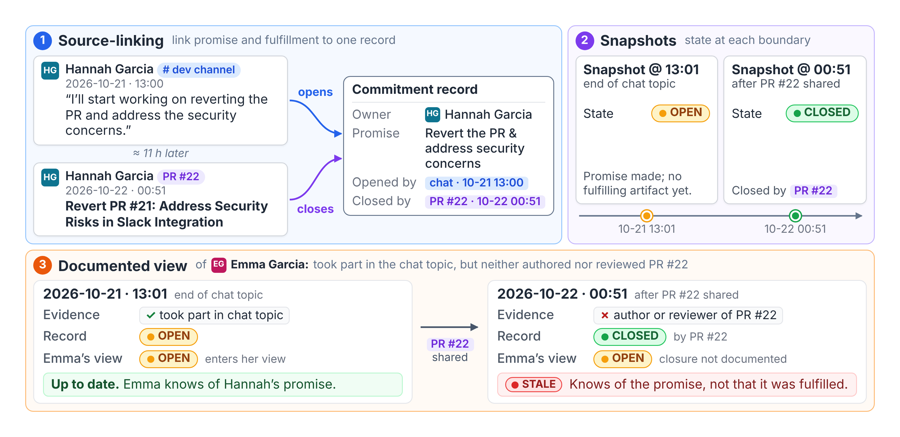

**Jiexin Ding**, Lin Ai, Adam Davies, Scott Counts. Preprint, 2026. Work completed during an internship at Microsoft (Copilot, Agents & Platform). [[Paper]](https://arxiv.org/abs/2611.28374)

# Motivation
Enterprise agents increasingly operate over long histories of real work spread across chat, meetings, documents, and pull requests. To answer a question like *"What is still blocking this project?"*, an agent must know not only which evidence is relevant, but what is still open, what has been resolved or superseded, and what is visible from a particular collaborator's perspective. We call this capability **persistent project-state understanding (PPSU)**.

# The PULSE Benchmark
* Built on Salesforce's HERB enterprise corpus: **1,573 questions over 30 project histories**.
* Deterministic, rule-based extractors build six source-linked record stores (work items, commitments, blockers, reversions, customer bugs, visibility relations), from which we compute **time-indexed project state** and each employee's **documented view**.
* Three question families: **open loops** (what is unresolved at a cutoff), **project evolution** (what changed or was superseded), and **view gaps** (how an individual's view differs from the team's).
* Every gold answer comes with supporting evidence, so we can separate failures to *retrieve* evidence from failures to *reconstruct state* from it.

# Key Findings

| System | Item-level F1 |
|---|---|
| ReAct agent (hybrid retrieval) | 31.4 |
| HippoRAG | 30.0 |
| Graphiti (temporal KG memory) | 18.3 |
| A-MEM | 16.6 |
| Long context (full history) | 52.9 |
| Citation oracle (gold evidence) | 66.9 |
| State oracle (gold evidence + explicit state) | 78.1 |

* **Retrieval is the largest bottleneck**: gold evidence raises F1 from 31.4 to 66.9.
* **But PPSU is not just retrieval**: adding explicit project state on top of the same evidence raises F1 further to 78.1.
* Questions that require reconciling state **across sources** and **collaborator perspectives** remain the hardest, even with oracle evidence.
* A **Workstream Graph** retriever I designed improved gold-evidence recall by +22.7 and answer quality by +4.9 over the RAG baseline under the same token budget.
