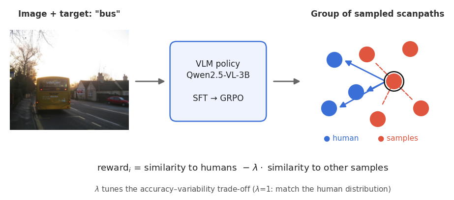

**Jiexin Ding**, Xinyun Liu, Ruotong Yu, Zhihan Zhang, Yuntao Wang, Shwetak Patel, Yue Jiang, Akshay Gadre. Under review, 2026. [[Paper]](https://drive.google.com/file/d/1diBcZHLuZOglUQNKuy4ITRXfikHLhld4/view?usp=sharing)

# Motivation
Human visual search is inherently variable: given the same image and target, different people follow different scanpaths. Predicting scanpaths supports attention-aware interfaces, foveated rendering for XR, and synthetic gaze data. Existing models capture only one side of the problem: accuracy-oriented models collapse to an "average" scanpath, while generative models capture variability but lose per-scanpath accuracy.

# Method
* We fine-tune **Qwen2.5-VL-3B** (LoRA) as a stochastic scanpath policy: **SFT** on human scanpaths, followed by **GRPO**.
* Instead of scoring each sampled scanpath on its own, we use a **distribution-matching (kernel-score) reward**: each sample is rewarded for resembling the human scanpaths and penalized, with weight λ, for resembling the other samples in its group.
* At λ = 1, maximizing this reward is equivalent to minimizing the maximum mean discrepancy (MMD) between model and human distributions; smaller λ sharpens the policy toward more representative scanpaths.

# Results
* On **COCO-Search18**, VLGaze achieves **state-of-the-art distributional metrics** while **matching or beating all baselines on accuracy**: it matches or outperforms all ten baselines on distributional metrics, leads sampling-based methods on seven of eight accuracy metrics, and matches the strongest deterministic model with greedy decoding.
* Varying λ traces a **tunable accuracy-variability frontier** closer to our theoretical lower bounds than any existing method.
