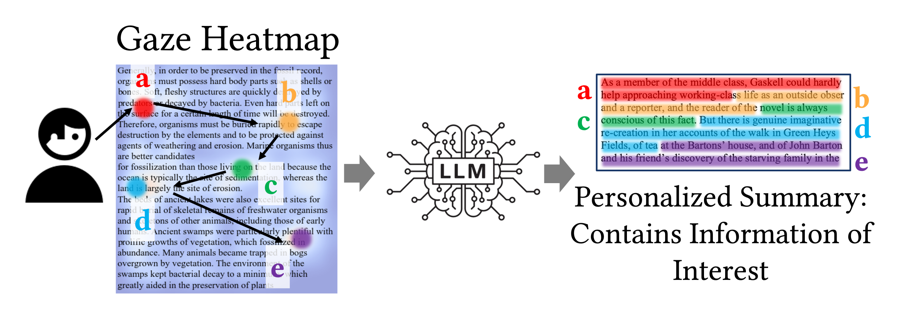

**Jiexin Ding**, Yizhuo Zhang, Xinyun Liu, Ke Chen, Yuntao Wang, Shwetak Patel, Akshay Gadre. HotMobile 2026. [[Paper]](https://dl.acm.org/doi/abs/10.1145/3789514.3792037)

# Motivation
Smart glasses are bringing LLM assistants into everyday life, but today's personalization relies on explicit prompts, which are cumbersome: a user at a research talk would have to keep saying "this slide is important". Gaze tracking is becoming standard on XR headsets and next-generation smart glasses, making it a natural **implicit** signal of what a user cares about.

# What We Did
* Evaluated multiple **gaze representations** as LLM input for personalized summarization. **Gaze heatmaps** performed best, outperforming the other representations and even explicit user prompts at the phrase level.
* Built a **gaze-guided academic reading assistant** that automatically generates personalized summaries from gaze heatmaps.
* Ran a **user study (N = 10)** on a reading-then-writing task: GazeSummary outperformed text-only summarization and performed comparably to explicit prompt-based summarization, while requiring lower mental effort.
* Follow-up work fine-tunes a **lightweight 3B gaze-aware LLM** (SFT + RL) that matches Gemini 2.0 on personalized summarization.
