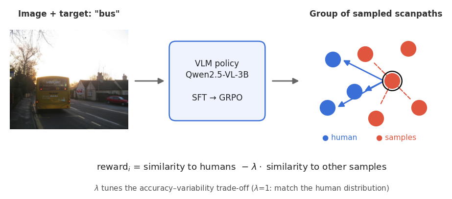

Human visual search is inherently variable. Given the same image and target, different observers follow different scanpaths. Predicting scanpaths, with applications ranging from gaze-aware interactive systems to the simulation of human users, therefore requires capturing both where people look and how their paths vary. Existing methods struggle to capture both simultaneously. Accuracy-oriented models tend to produce average scanpaths and lose variability, whereas generative models capture variability but trail on per-scanpath accuracy. We present VLGaze, which fine-tunes a vision-language model with reinforcement learning, rewarding human-like scanpaths while penalizing similarity among samples within each group. A single coefficient λ controls the trade-off between per-scanpath accuracy and variability. On COCO-Search18, VLGaze matches or outperforms all ten baselines in distributional metrics and leads sampling-based methods on seven of eight accuracy metrics, matching the strongest deterministic model with greedy decoding. Varying λ traces an accuracy-variability frontier closer to our theoretical lower bounds than any existing method.

[Download paper here](https://drive.google.com/file/d/1diBcZHLuZOglUQNKuy4ITRXfikHLhld4/view?usp=sharing)
