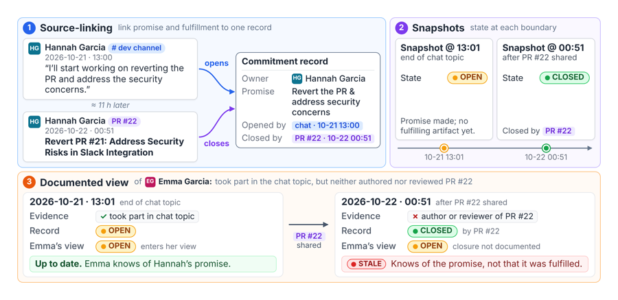

Enterprise agents must maintain an up-to-date understanding of work distributed across heterogeneous artifacts, evolving over time, and unevenly visible to different collaborators. We formulate this challenge as persistent project-state understanding (PPSU) and introduce PULSE, a benchmark of 1,573 questions over 30 enterprise project histories. PULSE constructs deterministic, time-indexed project state and documented collaborator views from source-linked records, and evaluates three families of questions: open loops, project evolution, and view gaps. Across retrieval agents, graph- and memory-augmented retrieval, long-context, and oracle conditions, we find substantial headroom for current systems. Retrieval and extraction account for the largest share of the gap, but providing explicit project state on top of gold evidence yields further substantial gains, showing that PPSU cannot be reduced to retrieval alone. Further analysis shows that questions requiring information to be reconciled across multiple parts of the project history remain difficult even when the relevant evidence is provided, while project-state synthesis and perspective conditioning remain persistent challenges. These results motivate enterprise agents that explicitly maintain and reconcile temporally grounded state across sources, actors, and time.

Work completed during an internship at Microsoft.

[Download paper here](https://arxiv.org/abs/2611.28374)
